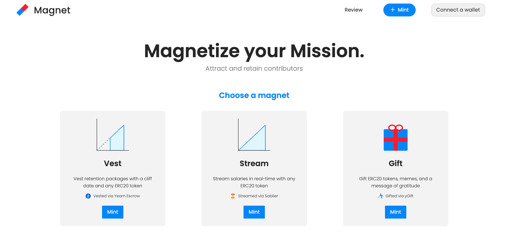

# 🟦🟥 Magnet

**Magnetize your Mission.**

Onchain payroll platform for DAOs.

[Open Magnet](http://magnet-app.s3-website-us-east-1.amazonaws.com/)



## Why

DAOs like [Yearn](https://twitter.com/iearnfinance) and [Synthetix](https://twitter.com/synthetix_io) move at lightspeed because they align builders around a shared mission. Compensation is how you attract, align, and retain that talent — and the tooling has been painful. Magnet simplifies payroll from end to end.

## What is Magnet?

Magnet makes it easy to issue salaries, vesting packages, and bonuses to employees or contributors. You draft compensation plans in the app and then submit them to your [Gnosis Safe](https://gnosis-safe.io/) multisig for review by the committee. Once all signatures are approved, the transaction is submitted onchain. 

Three composable primitives, each backed by a battle-tested protocol:

- **Vest** ERC20 tokens with a cliff date — via [yearn-vesting-escrow](https://github.com/banteg/yearn-vesting-escrow)
- **Stream** salaries in real time — via [Sablier](https://github.com/sablierhq/sablier)
- **Bonus** ERC20 bonuses with a message and image — via [yGift](https://github.com/yearn/ygift)

[Learn more](https://twitter.com/WillHennessy_/status/1391646532697481220).

## The workflow

**Mint.** Tailor a package per contributor — vesting, streaming, gifting, or any combination. Magnet bundles every transaction into a single batched call and sends it to your Gnosis Safe with one click.

**Review.** Your multisig sees the whole package on one screen: start date, cliff, duration, lifetime value, and the yGift image. We love Gnosis Safe — Magnet is a huge usability upgrade on top of it for compensation reviews specifically.

## How it works

Magnet is split across two repos:

- **magnet-app** (this repo) — Gatsby + React frontend. Connects to Gnosis Safe, builds compensation packages, and batches transactions through [Gnosis MultiSend](https://github.com/gnosis/safe-contracts) so the whole package ships as one Safe transaction.
- **[magnet-core](https://github.com/magnet-finance/magnet-core)** — Solidity smart contracts (Hardhat). Defines a native `Magnet.sol` primitive with `Funder` and `VestingMagnet` structs, plus `mintVestingMagnet` / `deposit` / `withdraw` flows. Includes a gas-efficient `depositMany` that batches deposits across magnets and groups ERC20 transfers by token, and view helpers like `getVestedAmount`, `getAvailableBalance`, and `getLifetimeValue` for any frontend that needs to render package state.

The deployed app currently composes the external protocols listed above. `magnet-core` is the native primitive that will replace them over time.

## Deployed contracts

| Contract | Mainnet | Rinkeby Testnet |
| --- | --- | --- |
| yearn-vesting-escrow | 0xF124534bfa6Ac7b89483B401B4115Ec0d27cad6A | 0x2836925b66345e1c118ec87bbe44fce2e5a558f6 |
| Sablier | 0xA4fc358455Febe425536fd1878bE67FfDBDEC59a | 0xc04Ad234E01327b24a831e3718DBFcbE245904CC |
| yGift | 0x020171085bcd43b6FD36aD8C95aD61848B1211A2 | 0x7396352b217cd712a81463e5397f685e1a4965a1 |
| Gnosis MultiSend | 0x8D29bE29923b68abfDD21e541b9374737B49cdAD | 0x8D29bE29923b68abfDD21e541b9374737B49cdAD |

## Feature backlog

Check out our [Figma UX board](https://www.figma.com/file/pqukEVdFaa2DC8Dr7S0osz/Magnet-App-shared?node-id=0%3A1) for ideas!

- Glassdoor-style compensation features (e.g. top paying DAOs, top earning contributors)
- Withdrawal UI for contributors to claim their rewards
- ENS integration for address names and profile images
- Support more wallets beyond the current injected provider, via [web3-react](https://github.com/NoahZinsmeister/web3-react)
- On the review page, display which multisig members have already approved or rejected the transactions

## Developer guide

Pull requests are warmly welcome! To get started:

```
git clone https://github.com/magnet-finance/magnet-app
yarn install
yarn start
```

Then visit `localhost:8000` in your browser.
